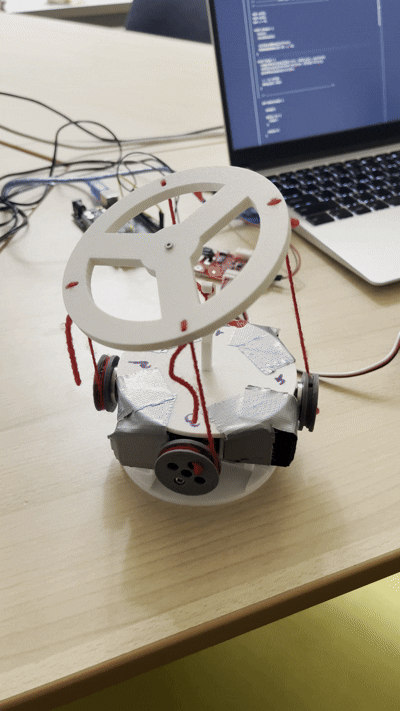
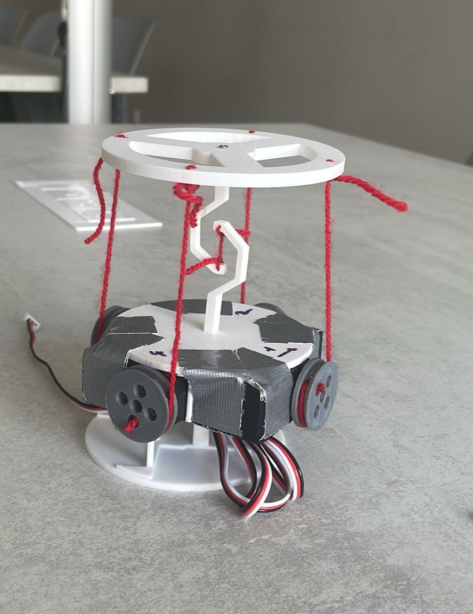

# Articulated Arm Operating on the Tensegrity Principle
> 🌍 Lire en [Français](README.fr.md).
---

  
   
  <em>Figure 1: Tensegrity robot prototype with its 4 servomotors.</em>

## About the Project
The goal of this project is to create a poly-articulated robotic arm based on the tensegrity principle. All 3D printing files are available in [`/CAD`](./CAD). The driver is available in [`/Driver`](./src/Driver).

## Hardware
* Arduino Mega
* 4x FEETECH STS3215 Servomotors
* External power supply: Adjustable universal AC adapter 12 W, 7.5 V
> ⚠️ **Power Supply Note:** The tensegrity principle requires constant mechanical tension on the cables. The motors consume current even when holding position. A 7.5 V power supply capable of delivering at least 4 A to 5 A is highly recommended to prevent voltage drops during simultaneous movements.

## Mathematical Principle
The objective is to define the orientation of the mobile platform along two axes of rotation:

| Variable | Description |
| :--- | :--- |
| $\alpha$ | Pitch angle |
| $\beta$ | Roll angle |
| $R$ | Base radius (47.5 mm) |
| $H$ | Distance between the two platforms (85 mm) |
| $r$ | Winding drum radius (12.5 mm) |
| $nb\_inc$ | Number of increments per turn of the STS3215 (4096) |
| $l_i$ | Length of the cables at each anchor point |

* The target length of each cable is calculated as follows:
  * $l_1 = \sqrt{(R\sin(\alpha)+H)^2 + (R\cos(\alpha)-R)^2}$
  * $l_2 = \sqrt{(R\cos(\beta)-R)^2 + (R\sin(\beta)\cos(\alpha)+H)^2 + (R\sin(\beta)\cos(\alpha))^2}$
  * $l_3 = \sqrt{(R - R\cos(\alpha))^2 + (H-R\sin(\alpha))^2}$
  * $l_4 = \sqrt{(R - R\cos(\beta))^2 + (H - R\sin(\beta)\cos(\alpha))^2 + (R\sin(\beta)\cos(\alpha))^2}$

* The angular position of the servomotors can then be determined in terms of increments:
  * $p_i  = \frac{H-l_i}{2\pi r}\times nb\_inc$

## Software Configuration and Bus
The FEETECH STS3215 servomotors are daisy-chained on a 1-wire asynchronous serial bus (Half-Duplex) connected to the `Serial1` port of the Arduino Mega.

* **Servo bus baudrate:** 1,000,000 bps
* **PC console baudrate:** 115,200 bps
* **Servo IDs:** `1`, `2`, `3`, and `4`

## Command Interface (Serial)
The robot listens to text commands on the USB communication port (`Serial` at 115,200 baud). The available commands are:

* **Configuration / Calibration Mode:**
  * `p1=val`, `p2=val`, `p3=val`, `p4=val`: Adjusts the raw position (in increments) of each servomotor to align the structure.
  * `o`: Validates the current configuration, saves the offsets, and launches the main application.

* **Operation Mode:**
  * `a=val`: Modifies the tilt angle $\alpha$ (pitch).
  * `b=val`: Modifies the tilt angle $\beta$ (roll).

  
   
  <em>Figure 2 : Prototype du robot par tenségrité avec ses 4 servomoteurs.</em>

